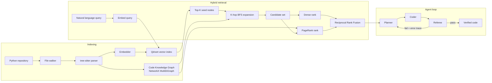
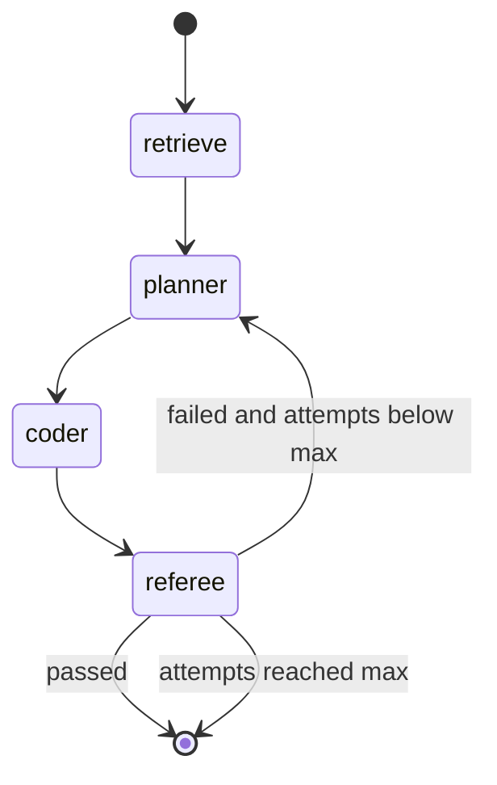

# GraphRAG Codebase Engine

[](https://github.com/shivangi911/graphrag-codebase-engine/actions/workflows/ci.yml)


A local, zero-cost **codebase intelligence engine**. It parses a Python repository into a
**Code Knowledge Graph (CKG)**, retrieves context for a natural-language query with a **hybrid of
dense vector search, K-hop graph expansion and Reciprocal Rank Fusion (RRF)**, and drives a
**LangGraph planner / coder / referee loop** whose output is verified by `ruff`, `mypy` and
`pytest` in a sandbox.

Everything runs locally on CPU: open-source libraries, open weights, an embedded vector store, and
a free Hugging Face dataset (SWE-bench) for evaluation. No API keys.

**Why graph retrieval?** Standard RAG splits code into linear chunks, which breaks control flow,
caller/callee relationships, class hierarchies and import dependencies. A function's meaning often
lives in the functions it calls and the ones that call it. This project models those relationships
explicitly and uses them at retrieval time.

---

## Table of contents

1. [Headline results](#1-headline-results)
2. [Architecture](#2-architecture)
3. [Mathematical foundations](#3-mathematical-foundations)
4. [Components in detail](#4-components-in-detail)
5. [Evaluation methodology](#5-evaluation-methodology)
6. [Results](#6-results)
7. [Installation and setup](#7-installation-and-setup)
8. [Usage](#8-usage)
9. [Configuration reference](#9-configuration-reference)
10. [Repository layout](#10-repository-layout)
11. [Testing and quality gates](#11-testing-and-quality-gates)
12. [Design decisions](#12-design-decisions)
13. [Limitations and future work](#13-limitations-and-future-work)
14. [License](#14-license)

---

## 1. Headline results

Retrieval benchmark on **51 SWE-bench instances** (psf/requests: 30, pallets/flask: 11,
pytest-dev/pytest: 10). The issue text is the query; the ground truth is the set of files edited
by the gold patch. Both methods return 20 nodes. Embedder: `BAAI/bge-small-en-v1.5` (CPU).

| Metric | Vector-only | GraphRAG (BFS + RRF) | Change |
|---|---|---|---|
| MRR | 0.463 | **0.586** | +0.12 |
| hit@1 | 0.294 | **0.451** | +0.16 |
| hit@10 | 0.804 | **0.882** | +0.08 |
| recall@10 | 0.731 | 0.806 | +0.07 |
| symbol hit@10 | 0.275 | **0.392** | +0.12 |

The gain is concentrated at the top of the ranking (the correct file is ranked first more often)
and in locating the right function. Mid-depth recall is roughly unchanged and was slightly worse on
flask. These are preliminary: the sample is small and no confidence intervals have been computed
for these runs yet. See [Results](#6-results) for the per-repo tables and caveats.

---

## 2. Architecture

### 2.1 End-to-end pipeline



### 2.2 The Code Knowledge Graph

```
                    File: auth.py
                         | DEFINES
                         v
                    Class: AuthHandler
                         | DEFINES
                         v
                    Function: AuthHandler.verify_token ---CALLS---> Function: decode_jwt
                         |                                              |
                         +--USES_TYPE--> External: str                  +--CALLS--> External: jwt.decode
```

| Node type | Meaning |
|---|---|
| `File` | A `.py` source file; id is the path relative to the repo root |
| `Class` | A class definition; id `path::Outer.Inner` |
| `Function` | A function or method; id `path::Class.method` or `path::outer.inner` |
| `External` | A symbol that could not be resolved to code in the repo (stdlib, third-party) |

| Edge type | Direction | Meaning |
|---|---|---|
| `DEFINES` | parent to child | A file defines a class or function; a class defines a method; a function defines a nested function |
| `CALLS` | caller to callee | A call expression inside the caller's body |
| `INHERITS_FROM` | class to base class | Base class in the class definition |
| `IMPORTS` | file to file | `import x` / `from x import y` resolved to a file in the repo |
| `USES_TYPE` | function to class | A class named in a parameter or return annotation |

The `Variable` and `Import` node types from the original specification are reserved in the schema
(`models.py`) but not emitted: imports are modelled as `IMPORTS` edges between files instead.

### 2.3 The agent state machine



| Node | Input | Output |
|---|---|---|
| `retrieve` | query | `retrieved_context`: ranked graph nodes with code |
| `planner` | query, context, and (on retry) previous code plus referee error trace | `generated_plan` |
| `coder` | query, plan, tests, and (on retry) error trace | `generated_code`; `refactor_attempts += 1` |
| `referee` | generated code, optional tests | `verification_passed`, `error_trace`, a `history` entry |

The routing rule after the referee is: stop if `verification_passed` or
`refactor_attempts >= max_refactor_attempts` (default 3); otherwise return to the planner with the
error trace.

---

## 3. Mathematical foundations

### 3.1 Code Knowledge Graph

The CKG is a directed multi-graph

$$G = (V, E, \tau_V, \tau_E)$$

with node types $\tau_V : V \to \{\text{File}, \text{Class}, \text{Function}, \text{External}\}$ and
edge types
$\tau_E : E \to \{\text{DEFINES}, \text{CALLS}, \text{INHERITS\_FROM}, \text{IMPORTS}, \text{USES\_TYPE}\}$,
where $E \subseteq V \times V \times \mathcal{R}$. It is a multi-graph because two nodes can be
related in more than one way (for example a function can both call and annotate with the same
class).

**Symbol resolution.** The parser only sees names (for example the call `self.decode(token)`
yields the symbolic target `decode`). For a symbolic edge $e = (u, t, r)$ with simple name
$\nu(t)$ (the last dotted segment) let the type-compatible candidate set be

$$C(e) = \{ v \in V : \tau_V(v) \in T_r,\ \text{name}(v) = \nu(t) \}$$

where $T_r = \{\text{Function}, \text{Class}\}$ for `CALLS` and $\{\text{Class}\}$ for
`INHERITS_FROM` and `USES_TYPE`. Let $C_{\text{file}}(e)$ be the candidates defined in the same
file as the source $u$. The edge is resolved to

$$
\text{resolve}(e) =
\begin{cases}
\{\text{first of } C_{\text{file}}(e)\} & C_{\text{file}}(e) \neq \emptyset \\
C(e) & 1 \le |C(e)| \le 3 \\
\{\text{External}(\nu(t))\} & \text{otherwise}
\end{cases}
$$

Same-file definitions win because they are the most likely referent; a small ambiguous set is
linked in full; a large ambiguous set (a very common name) is not guessed and becomes an
`External` node. `IMPORTS` targets are matched against file paths (`a/b.py` or
`a/b/__init__.py`).

### 3.2 Dense retrieval

Each `Function` and `Class` node $v$ is embedded as $f(v) \in \mathbb{R}^d$ from the text
`type name + docstring + first 1500 characters of code`. A query $q$ is embedded with the same
model. Embeddings are L2-normalised, so cosine similarity is a dot product:

$$s(q, v) = \cos\big(f(q), f(v)\big) = \frac{f(q) \cdot f(v)}{\lVert f(q) \rVert_2 \, \lVert f(v) \rVert_2} = f(q) \cdot f(v)$$

The seed set is the top-$K_s$ nodes by cosine similarity ($K_s = 5$ by default), retrieved from
Qdrant:

$$S_0 = \operatorname*{arg\,top\text{-}K_s}_{v \in V_{\text{code}}} \; s(q, v)$$

### 3.3 Topological K-hop expansion

Let $\text{dist}_G(v, u)$ be the length of the shortest path between $v$ and $u$ in the
**undirected projection** of $G$ (edge direction is ignored by default so that both callees and
callers are reached; a directed mode is available). The expanded set is

$$N_K(S_0) = S_0 \cup \{ u \in V \mid \exists\, v \in S_0 : \text{dist}_G(v, u) \le K \}$$

with $K = 2$ by default. It is computed by breadth-first search in $O(|V| + |E|)$ time bounded by
the explored neighbourhood. The hop distance of each node is kept and reported but does not enter
the ranking directly. `External` and `File` nodes are traversed but excluded from the final
candidate set $C = N_K(S_0) \cap V_{\text{code}}$, where
$V_{\text{code}} = \{\text{Function}, \text{Class}\}$.

### 3.4 Graph centrality

The structural signal is PageRank over the (simple, parallel-edges-merged) directed graph:

$$\pi(v) = \frac{1 - \alpha}{|V|} + \alpha \sum_{u \to v} \frac{\pi(u)}{\text{outdeg}(u)}, \qquad \alpha = 0.85$$

PageRank is computed once over the whole graph, so it measures how central a node is in the
entire repository (functions that many others depend on score highly). Degree centrality is
available as an alternative signal.

### 3.5 Reciprocal Rank Fusion

For each candidate $v \in C$ define two 1-based ranks within $C$:

- $r_{\text{dense}}(v)$: rank by cosine similarity $s(q, v)$, highest first.
- $r_{\text{graph}}(v)$: rank by PageRank $\pi(v)$, highest first.

Ties are broken by node id for determinism. The fused score is

$$\text{RRF}(v) = \frac{1}{k + r_{\text{dense}}(v)} + \frac{1}{k + r_{\text{graph}}(v)}, \qquad k = 60$$

and the top $M = 20$ candidates by $\text{RRF}(v)$ are returned. RRF uses ranks, not raw scores,
so it needs no calibration between cosine similarities and PageRank values, which live on
different scales. With $k = 60$ the maximum possible score is $2 / 61 \approx 0.0328$, which is why
the printed scores look small (a top result is typically $0.03$).

Note that the dense rank is computed over the expanded candidate set (including neighbours that
were not vector seeds), using their cosine similarity to the query. A neighbour that is
semantically unrelated therefore gets a poor dense rank and can only rise through its centrality.

### 3.6 Evaluation metrics

For an instance with gold file set $F^*$ (files modified by the gold patch) and the retrieved
nodes mapped to a ranked list of unique files $f_1, f_2, \dots$ (a file takes the rank of its
best-ranked node):

$$\text{recall@}k = \frac{|F^* \cap \{f_1, \dots, f_k\}|}{|F^*|} \qquad
\text{hit@}k = \mathbb{1}\big[F^* \cap \{f_1, \dots, f_k\} \neq \emptyset\big]$$

$$\text{MRR} = \frac{1}{\min\{ i : f_i \in F^* \}} \quad (0 \text{ if no gold file is retrieved})$$

$$\text{symbol hit@}10 = \mathbb{1}\big[\text{names(top-10 nodes)} \cap S^* \neq \emptyset\big]$$

where $S^*$ is the set of function and class names taken from the hunk headers of the gold patch.
Reported values are means over instances.

**Paired bootstrap confidence intervals.** For two methods evaluated on the same instances, let
$d_i = m_i^{\text{GraphRAG}} - m_i^{\text{vector}}$ be the per-instance difference of a metric.
The 95% interval for the mean difference is the 2.5th to 97.5th percentile of
$\frac{1}{n}\sum_{i} d_{b(i)}$ over $B = 10{,}000$ resamples $b$ drawn with replacement. The
difference is flagged "CI excludes 0" when that interval does not contain zero. Pairing by
instance removes between-instance difficulty from the comparison.

---

## 4. Components in detail

### 4.1 AST parser (`ast_parser.py`)

Uses `tree-sitter` and `tree-sitter-python` to build a concrete syntax tree without regexes. A
recursive visitor carries a **scope stack**, so identifiers are qualified
(`path::Class.method`, `path::outer.inner`) and two classes with a method of the same name do not
collide. It extracts:

- classes (with base classes and docstrings), functions and methods (with source text, line
  range and docstring), including nested definitions;
- call expressions, attributed to the enclosing function (or class/file for module-level code);
- `import` / `from ... import` statements;
- parameter and return type annotations.

It works on bytes (tree-sitter offsets are byte offsets, so non-ASCII source is sliced
correctly), and tolerates syntax errors: tree-sitter's error recovery still yields the
well-formed parts of a broken file.

### 4.2 Graph builder (`graph_builder.py`)

A `networkx.MultiDiGraph`. Parsed files are added and symbolic edges are kept as raw edges until
`resolve()` is called, which rebuilds all edges using the rules in
[3.1](#31-code-knowledge-graph) (so resolution is idempotent and can be re-run after adding files).
Provides `deque`-based K-hop BFS (undirected or directed), PageRank and degree centrality, and JSON
persistence (`data/graph_store.json`).

### 4.3 Embedders (`embedder.py`)

| Backend | Model | Dimension | Notes |
|---|---|---|---|
| `sbert` | `BAAI/bge-small-en-v1.5` | 384 | Default for real results; CPU |
| `ollama` | `nomic-embed-text` | 768 | Needs `ollama serve` |
| `hash` | none | 384 | Deterministic signed feature hashing of identifier sub-tokens and bigrams; offline, used in tests |
| `auto` | | | Tries Ollama, then sbert, then hash |

The index records which embedder built it (`data/index_meta.json`); querying with a different
embedder raises a clear error instead of a dimension mismatch.

### 4.4 Vector store (`vector_store.py`)

Qdrant in embedded local mode (path on disk, or in memory for tests); a server URL can be
configured. Node vectors are also cached in memory so that scoring graph neighbours does not
re-embed them on every query.

### 4.5 Retriever (`retriever.py`)

Implements [3.2 to 3.5](#3-mathematical-foundations): vector seeds, K-hop expansion, dense and
PageRank ranks, RRF, top-$M$. It also exposes a `retrieve_vector_only` baseline used by the
evaluation. Each result carries `score`, `dense_score`, `hops` and `rank`.

### 4.6 Agent (`llm.py`, `sandbox.py`, `orchestrator.py`)

- **LLM:** a small protocol with an Ollama backend (`qwen2.5-coder:3b` by default) and a scripted
  `FakeLLM` for tests and offline demos.
- **Referee sandbox:** runs `ruff check`, `mypy` and (if tests are supplied) `pytest` on the
  generated module. Docker backend: a network-less container (`--network none --memory 512m
  --cpus 1`) built from `docker/sandbox.Dockerfile`. Subprocess backend: an isolated temp dir with a
  timeout. `auto` uses Docker when the image exists. Failures return a trimmed error trace that is
  fed back to the planner.
- **Orchestrator:** a real LangGraph `StateGraph` over a Pydantic `AgentState`, with a
  conditional edge implementing the retry rule in [2.3](#23-the-agent-state-machine).

### 4.7 Ingestion and evaluation (`ingest.py`, `evaluation.py`)

Walks a directory for `.py` files (skipping `.git`, virtualenvs, build output and files over
1 MB), builds the graph and the vector index. For SWE-bench it streams the dataset from Hugging
Face, shallow-clones the repository once (blobless), checks out each instance's `base_commit`,
indexes it, and scores retrieval against the gold patch. Per-instance metrics are saved as JSON so
results can be pooled and bootstrapped.

---

## 5. Evaluation methodology

- **Dataset:** [`SWE-bench/SWE-bench`](https://huggingface.co/datasets/SWE-bench/SWE-bench), test
  split, filtered by repository. Instances are taken in dataset order up to `--limit`.
- **Query:** the issue's `problem_statement`, truncated to 2000 characters.
- **Corpus:** every Python file at the instance's `base_commit` (including tests).
- **Ground truth:** files modified by the gold `patch`; symbols from its hunk headers.
- **Methods compared:** `vector-only` (top-20 by cosine similarity) and `graphrag (BFS+RRF)`
  (seeds, 2-hop expansion, RRF, top-20). Same embedder, same index, same node cap.
- **Metrics:** recall@k, hit@k, MRR, symbol hit@10 ([3.6](#36-evaluation-metrics)).

---

## 6. Results

Embedder `BAAI/bge-small-en-v1.5`, `top_k_vector = 5`, `bfs_max_hops = 2`, `rrf_k = 60`,
20 nodes returned.

### 6.1 Per repository

**psf/requests** (30 instances)

| method | recall@1 | recall@3 | recall@5 | recall@10 | hit@1 | hit@3 | hit@5 | hit@10 | MRR | symbol hit@10 |
|---|---|---|---|---|---|---|---|---|---|---|
| vector-only | 0.267 | 0.502 | 0.634 | 0.753 | 0.333 | 0.633 | 0.767 | 0.867 | 0.503 | 0.333 |
| graphrag | 0.372 | 0.530 | 0.693 | 0.826 | 0.467 | 0.633 | 0.800 | 0.933 | 0.606 | 0.467 |

**pallets/flask** (11 instances, which is all of flask in SWE-bench)

| method | recall@1 | recall@3 | recall@5 | recall@10 | hit@1 | hit@3 | hit@5 | hit@10 | MRR | symbol hit@10 |
|---|---|---|---|---|---|---|---|---|---|---|
| vector-only | 0.212 | 0.439 | 0.652 | 0.788 | 0.273 | 0.545 | 0.727 | 0.818 | 0.435 | 0.273 |
| graphrag | 0.356 | 0.523 | 0.553 | 0.848 | 0.545 | 0.636 | 0.636 | 0.909 | 0.630 | 0.455 |

**pytest-dev/pytest** (10 instances)

| method | recall@1 | recall@3 | recall@5 | recall@10 | hit@1 | hit@3 | hit@5 | hit@10 | MRR | symbol hit@10 |
|---|---|---|---|---|---|---|---|---|---|---|
| vector-only | 0.200 | 0.600 | 0.600 | 0.600 | 0.200 | 0.600 | 0.600 | 0.600 | 0.374 | 0.100 |
| graphrag | 0.300 | 0.600 | 0.700 | 0.700 | 0.300 | 0.600 | 0.700 | 0.700 | 0.475 | 0.100 |

Raw tables are in [`results/`](results/).

### 6.2 Pooled (51 instances, weighted by instance count)

| metric | vector-only | graphrag |
|---|---|---|
| recall@1 | 0.242 | 0.355 |
| recall@3 | 0.508 | 0.542 |
| recall@5 | 0.631 | 0.664 |
| recall@10 | 0.731 | 0.806 |
| hit@1 | 0.294 | 0.451 |
| hit@3 | 0.608 | 0.627 |
| hit@5 | 0.725 | 0.745 |
| hit@10 | 0.804 | 0.882 |
| MRR | 0.463 | 0.586 |
| symbol hit@10 | 0.275 | 0.392 |

### 6.3 Interpretation and caveats

- **Consistent:** MRR is higher with graph retrieval on all three repositories (+0.10, +0.19,
  +0.10), as is the top-1 hit rate. The right file is ranked first noticeably more often.
- **Function-level:** symbol hit@10 improves on requests and flask (tie on pytest at 0.10).
- **Not consistent:** at mid depth (recall@5, hit@5) GraphRAG was worse on flask
  (0.553 vs 0.652 and 0.636 vs 0.727), most likely because graph neighbours of a strong seed
  displace a second gold file at ranks 4 to 10.
- **pytest is hard for both methods** (hit@10 of 0.6 and 0.7, symbol hit 0.10): its issues often
  describe behaviour rather than naming code, and its plugin structure is large.
- **Small samples.** One instance moves a hit rate by 0.03 to 0.10. These runs predate the
  per-instance output, so no confidence intervals exist for them yet; do not read the
  differences as statistically established. Instances are the first $N$ in dataset order, not a
  random sample. The ground truth counts only edited files, so a retrieved file that helps a fix
  without being edited counts as a miss.
- Full results with bootstrap confidence intervals, more instances and a hops ablation will be
  added with `graphrag report` (see [Usage](#8-usage)).

---

## 7. Installation and setup

Requirements: Linux or macOS, Python 3.11, about 2 GB of free disk (more for the dataset clones),
no GPU. Optional: Ollama (code LLM) and Docker (sandbox).

```bash
git clone git@github.com:shivangi911/graphrag-codebase-engine.git
cd graphrag-codebase-engine

conda create -n graphrag-engine python=3.11 -y
conda activate graphrag-engine

# CPU-only PyTorch (much smaller than the default CUDA wheel)
pip install torch --index-url https://download.pytorch.org/whl/cpu
pip install -e ".[dev,embed,ollama,swebench]"
```

Optional components:

```bash
# real code generation (Ollama must be running: `ollama serve`)
ollama pull nomic-embed-text
ollama pull qwen2.5-coder:3b

# network-less container sandbox for the referee
docker build -t graphrag-sandbox -f docker/sandbox.Dockerfile .
```

Verify the install:

```bash
ruff check . && ruff format --check . && mypy && pytest
python scripts/run_demo.py        # offline end-to-end demo, no models required
```

---

## 8. Usage

### 8.1 Command line

```bash
# Build the graph and vector index for a repository (saved to ./data)
graphrag index /path/to/repo --embedder sbert

# Hybrid retrieval, and the vector-only baseline for comparison
graphrag query "where is the request body encoded?"
graphrag query "where is the request body encoded?" --vector-only

# Planner / coder / referee loop (optionally with a pytest file for module `solution`)
graphrag refactor "simplify verify_token" --llm ollama --tests tests_for_solution.py

# SWE-bench retrieval benchmark; writes results/eval_<owner>__<repo>.md and .json
graphrag eval --repo psf/requests --limit 30 --embedder sbert

# Pool several eval runs into one summary with confidence intervals
graphrag report results/eval_*.json --output results/summary.md
```

`query` and `refactor` automatically use the embedder the index was built with. An index built
with one embedder cannot be queried with another.

### 8.2 Ablations

Settings can be overridden per run with environment variables:

```bash
BFS_MAX_HOPS=1 graphrag eval --repo psf/requests --limit 30 --embedder sbert \
  --output results/eval_requests_hops1.md
```

### 8.3 Python API

```python
from pathlib import Path
from graphrag_engine.embedder import get_embedder
from graphrag_engine.ingest import build_index
from graphrag_engine.retriever import HybridGraphRAGRetriever

ckg, store = build_index(Path("path/to/repo"), get_embedder(backend="sbert"))
retriever = HybridGraphRAGRetriever(ckg, store)
for node in retriever.retrieve_context("how are sessions merged?"):
    print(node["rank"], node["id"], node["score"], node["hops"])
```

---

## 9. Configuration reference

Settings come from environment variables or a `.env` file (see `.env.example`); names are the
upper-case field names.

| Variable | Default | Meaning |
|---|---|---|
| `DATA_DIR` | `data` | Index, clones and graph output |
| `EMBEDDING_BACKEND` | `auto` | `auto`, `sbert`, `ollama`, `hash` |
| `EMBEDDING_MODEL` | `BAAI/bge-small-en-v1.5` | sentence-transformers model |
| `OLLAMA_EMBEDDING_MODEL` | `nomic-embed-text` | Ollama embedding model |
| `OLLAMA_HOST` | `http://localhost:11434` | Ollama server |
| `QDRANT_COLLECTION` | `code_nodes` | Collection name |
| `QDRANT_URL` | unset | Use a Qdrant server instead of embedded mode |
| `TOP_K_VECTOR` | `5` | Number of dense seeds ($K_s$) |
| `BFS_MAX_HOPS` | `2` | Expansion depth ($K$) |
| `RRF_K_CONSTANT` | `60` | RRF constant ($k$) |
| `MAX_CONTEXT_NODES` | `20` | Nodes returned ($M$) |
| `LLM_BACKEND` | `fake` | `fake` or `ollama` |
| `LLM_MODEL` | `qwen2.5-coder:3b` | Ollama code model |
| `MAX_REFACTOR_ATTEMPTS` | `3` | Retry limit for the agent loop |
| `SANDBOX_BACKEND` | `auto` | `auto`, `docker`, `subprocess` |
| `SANDBOX_TIMEOUT_S` | `60` | Per-tool timeout |
| `SANDBOX_IMAGE` | `graphrag-sandbox:latest` | Docker image for the referee |

---

## 10. Repository layout

```text
graphrag-codebase-engine/
├── .github/workflows/ci.yml      # ruff, mypy, pytest
├── docker/sandbox.Dockerfile     # pytest + mypy + ruff image for the referee
├── scripts/run_demo.py           # offline end-to-end demo
├── src/graphrag_engine/
│   ├── config.py                 # Pydantic settings
│   ├── models.py                 # Node, Edge, NodeType, Relation
│   ├── ast_parser.py             # tree-sitter visitor
│   ├── graph_builder.py          # CKG, symbol resolution, BFS, PageRank, persistence
│   ├── embedder.py               # sbert / Ollama / hash embedders
│   ├── vector_store.py           # Qdrant index and cached node vectors
│   ├── retriever.py              # hybrid retriever, RRF
│   ├── llm.py                    # Ollama and scripted fake LLM
│   ├── sandbox.py                # Docker and subprocess referee
│   ├── orchestrator.py           # LangGraph state machine
│   ├── ingest.py                 # directory indexing, SWE-bench loading
│   ├── evaluation.py             # metrics, bootstrap CIs, pooling
│   └── cli.py                    # `graphrag` command
├── tests/
│   ├── unit/                     # parser, graph, retriever/RRF, sandbox, evaluation
│   └── integration/              # agent loop, end-to-end indexing and retrieval
├── results/                      # evaluation outputs
├── pyproject.toml
├── LICENSE
└── README.md
```

---

## 11. Testing and quality gates

```bash
ruff check . && ruff format --check . && mypy && pytest --cov=graphrag_engine
```

45 tests run offline (no Docker, Ollama or network) using the deterministic hash embedder and a
scripted LLM. They cover: parser scoping, nested definitions, syntax errors and
non-ASCII source; cross-file symbol resolution; BFS depth and directed mode; PageRank
normalisation; RRF checked against hand-computed values; retrieval that expands through the graph;
persistence and the embedder-mismatch error; the agent retrying with the referee's error trace and
stopping at the attempt limit; patch parsing and metrics; and the bootstrap. CI runs the same
gates on GitHub Actions with Python 3.11. `mypy` runs in strict mode.

---

## 12. Design decisions

| Decision | Reason |
|---|---|
| tree-sitter instead of regex or `ast` | Error-tolerant, byte-accurate, and extensible to other languages |
| Qualified node ids (`path::Class.method`) | Avoids collisions between same-named methods |
| Lazy symbol resolution after all files are parsed | Cross-file calls cannot be resolved while parsing a single file |
| Undirected BFS by default | A hit's callers matter as much as its callees for understanding it |
| RRF over ranks, not scores | Cosine similarity and PageRank are on incomparable scales |
| PageRank computed globally, not on the candidate subgraph | A stable measure of repository-wide importance |
| Pluggable embedder / LLM / sandbox | Runs on a CPU-only machine and in CI with no models or Docker |
| Embedded Qdrant | No server to run; same API as a server deployment |
| Index records its embedder | Prevents silent or crashing dimension mismatches |
| Per-instance JSON + paired bootstrap | Lets claims about GraphRAG vs vector-only be tested, not just eyeballed |

Differences from the original project specification: a real hybrid retriever (the specified
version took the first K functions and ignored the query), a real LangGraph loop with a sandboxed
referee (the specified orchestrator was a stub), resolved cross-file edges, qualified ids,
`MultiDiGraph`, `deque`-based BFS, and an evaluation harness.

---

## 13. Limitations and future work

**Limitations**

- Python only. Call resolution is by name, not by type or import binding, so common names can
  link to the wrong definition or remain `External`.
- The dense rank for non-seed neighbours uses their own embeddings; graph neighbours that are
  unrelated to the query can still enter the top results through centrality.
- The subprocess sandbox is a convenience, not a security boundary. Use the Docker backend
  (`--network none`) for untrusted code.
- The hash embedder is a lexical fallback for offline use and tests, not for quality results.
- Current results use small, first-$N$ samples; the agent loop has not been benchmarked on
  SWE-bench task resolution, only on retrieval.

**Future work**

- Type- and import-aware call resolution (jedi or pyright), and more languages.
- Learned or weighted fusion in place of equal-weight RRF; query-dependent hop depth.
- Graph-aware reranking (cross-encoder over a node plus its neighbours).
- End-to-end SWE-bench resolution rate with the agent loop and a stronger code model.
- Larger, randomly sampled evaluations with a hops and fusion ablation.

---

## 14. License

[MIT](LICENSE) © 2026 Shivangi Mittal
